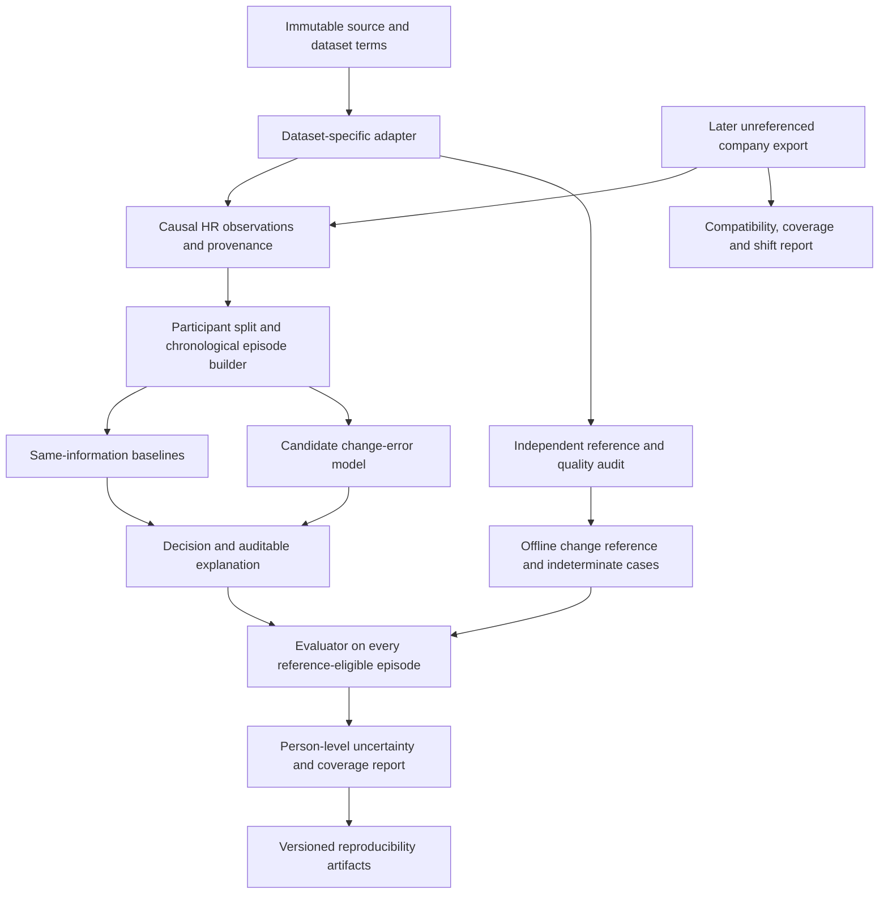

# Architecture and implementation boundaries

The pipeline separates information available to a monitoring algorithm from the
independent reference used to evaluate it. This prevents an apparently accurate
model from receiving its own answer through preprocessing, calibration or an
explanation field.

The diagram describes the intended study. The initial implementation contains
only contracts, elementary baselines, evaluation accounting and a synthetic
replay. Dataset adapters, model training, statistical uncertainty estimation,
external locking and the company package remain planned.

## Implemented foundation

- `hr_change/` holds reference-free model inputs, paired offline evaluation
  records, validation, elementary causal baselines and accounting metrics.
- `scripts/run_synthetic_demo.py` creates invented episodes and an immutable new
  run directory. Its purpose is to demonstrate the interfaces and reveal
  denominator/temporal failures before patient data are used.
- `scripts/verify_run.py` independently checks saved outputs and provenance.
- `tests/` tests the important research invariants using synthetic examples.
- `configs/` contains hand-authored synthetic configuration. These values do not
  define the future scientific thresholds.

See the actual module docstrings for executable interfaces. They are deliberately
smaller than the eventual dataset contract in [DATA_CONTRACT.md](DATA_CONTRACT.md).

## Planned research components

| Component | Inputs | Outputs and boundary |
|---|---|---|
| Source registry / adapter | Licensed immutable source, documented units/time base | Canonical observations; missing fields stay unknown; source hashes |
| Reference audit | ECG/reference stream and independent quality rules | Usable reference intervals, uncertainty and exclusions; never a model feature |
| Split and episode builder | Participant groups, chronology, chosen intervals | Nonoverlapping episodes, development/calibration/evaluation roles, exposure record |
| Baseline fitter | Development-only causal inputs and development targets | Frozen baseline parameters, dependency and fitting provenance |
| Candidate fitter | Same allowed inputs and fitting budget | Change estimate and uncertainty, with justified assumptions |
| Calibrator / decision rule | Reserved development calibration partition | Frozen thresholds and abstention rule; no external outcome access |
| Evaluator | Frozen predictions and independent references | All-eligible and accepted-set metrics; person-level analysis |
| Explanation renderer | Actual model inputs, intermediates and decision rule | Values, change, interval, support and reason codes; no diagnostic prose |
| Company adapter/report | Later raw export and field/process sheet | Engineering report unless independent reference fields are supplied |

Use distinct objects/columns for signal acquisition time, receipt/availability
time, decision time, reference time and retrospective annotation time. A source
with unknown receipt time can support a retrospective signal-time experiment;
it does not prove online availability.

## Method comparison structure

Fix an HR estimator first. Compare point-error-based filtering with direct
change-error inference on the same numerical stream. Then compare corrections
on the same accepted episodes to isolate numerical improvement from selection.
Direct change regression with ordinary calibrated intervals is a required strong
baseline, not the proposed method under another name.

Raw PPG or acceleration may be added as a clearly labeled richer-information
ablation. A method that sees these signals is not a same-information competitor
to a scalar-only method. Pretraining and transfer are optional; any advantage
must survive an equivalent-data simple baseline and a disclosed tuning budget.

Do not build a general model zoo. Add a module only after a recorded hypothesis
needs it, and retain a runnable end-to-end path with small fixtures.
